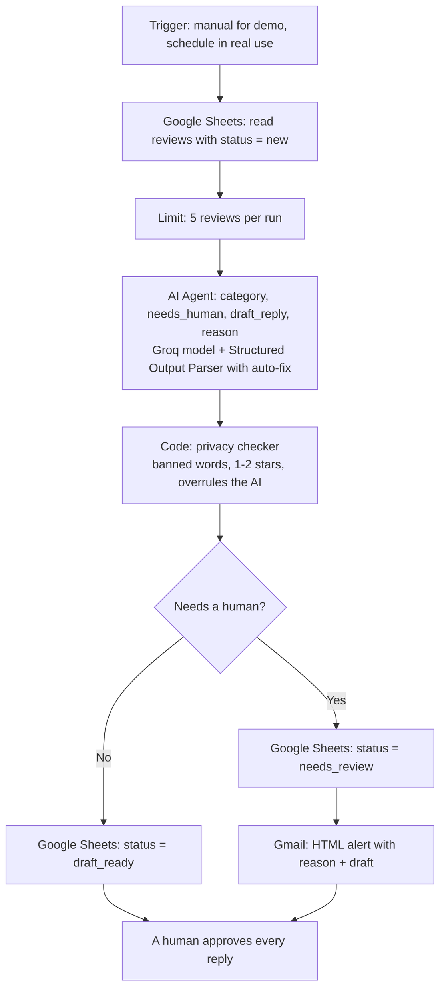
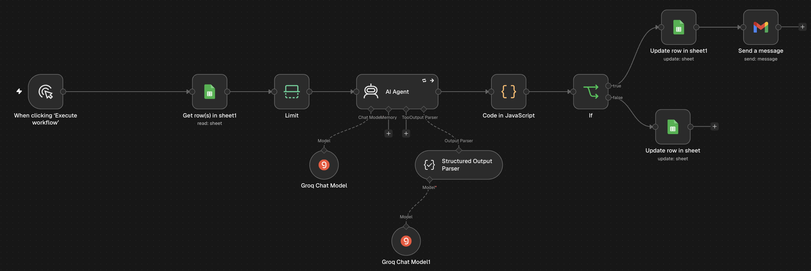
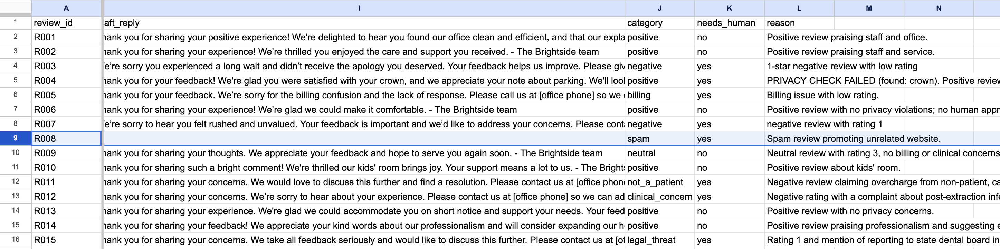
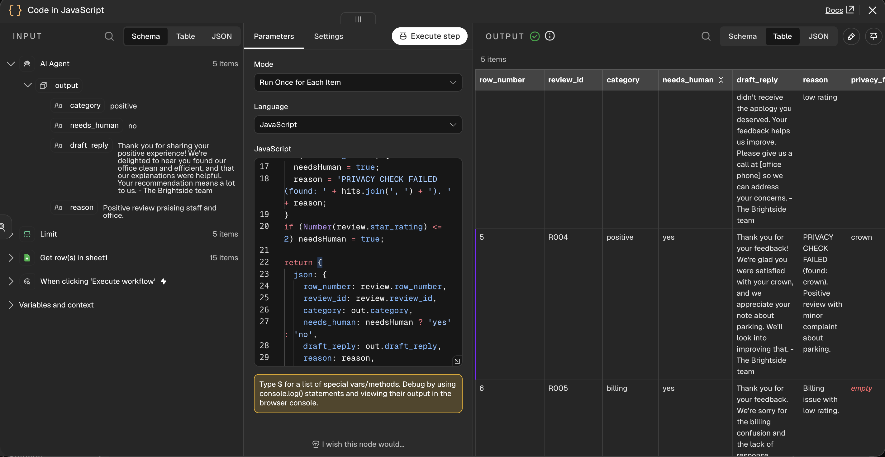

# Review Reply Agent (n8n)

An n8n AI agent that reads Google reviews for a hospital or clinic, **sorts each one by risk, drafts a privacy-safe reply, and sends anything risky to a human.** Nothing is ever posted automatically.

> **Independent portfolio project.** Not built for any company. All reviews are **fictional** (a made-up clinic, "Brightside Family Dental"). No real patient data was used.

---

## The idea in one line

**AI for judgement. Code for guarantees. A human for accountability.**

| Job | Who does it | Why |
|---|---|---|
| Reading tone, sorting into 8 categories, writing a first draft | **AI Agent** (Groq, `openai/gpt-oss-20b`; output repair with `gpt-oss-120b`) | Needs judgement |
| Banned words, rating thresholds, batching, retries, status tracking | **Code** and workflow rules | Exact and repeatable; can overrule the AI |
| Final approval of every reply | **A person** | A public reply that confirms someone is a patient breaks patient confidentiality |

---

## How it works

**8 categories:** positive, neutral, negative, billing, clinical_concern, spam, not_a_patient, legal_threat

---

## Results on 15 trap reviews

- **High-risk reviews sent to a human: 7 of 7** (billing, spam, complaints, clinical concern, not-a-patient, legal threat)
- **Spam:** empty reply, no engagement
- **But:** 6 of the 8 replies the AI marked "safe" still hinted that the reviewer was a patient (for example "glad you enjoyed your cleaning with Dr. Patel"). The final word list catches 4 of those 6. The other 2 depend on human approval.

That result is why the final design keeps a person approving **every** reply.

| Sheet after all 3 runs | Privacy checker overruling the AI (R004: "crown") |
|---|---|
|  |  |

---

## What broke

Eight problems, from a leftover empty node to rate limits to privacy leaks. Full log: [docs/what-broke.md](docs/what-broke.md)

---

## Repo contents

| Path | What it is |
|---|---|
| `workflow/` | The exported n8n workflow (import it with **⋯ → Import from file**) |
| `data/reviews_sample.csv` | The 15 fictional test reviews, with their traps |
| `prompts/` | System message, user message, output parser JSON example |
| `code/privacy-checker.js` | The Code node that can overrule the AI |
| `email-templates/needs-review-alert.html` | The HTML alert email |
| `docs/what-broke.md` | Every problem and fix |
| `screenshots/` | Results from the test runs |

---

## Run it yourself

1. Import the workflow JSON into n8n (Cloud or self-hosted).
2. Make a Google Sheet with the columns in `data/reviews_sample.csv` plus `draft_reply`, `category`, `needs_human`, `reason`, and import the CSV.
3. Connect your own credentials: Google Sheets, Gmail and a Groq API key (both Groq model nodes).
4. In both Google Sheets nodes, pick your own sheet (the export has a placeholder). In the Gmail node, set **To** to your own email address.
5. Click **Execute workflow**. Each run handles the next 5 reviews with status `new`.

---

## Limits

- 15 fictional reviews show failure types, not accuracy rates.
- Not connected to a real Google Business Profile; nothing is posted.
- The banned-word list is a safety net, not a guarantee.
- **Known gap:** the AI Agent retries 3 times, then continues on error. A review that still fails reaches the privacy checker with no AI output and, if it has 3+ stars, would be saved as `draft_ready` with an empty draft. Fix: in `code/privacy-checker.js`, treat a missing `category` as `needs_human = yes`.

## Next steps

- One-click approve / edit / reject, in the Sheet or Slack
- Post approved replies through the Google Business Profile API
- A second AI "compliance reviewer" as an extra layer, not a replacement for the human
- Re-test on a hospital review set (OPD waiting times, emergencies, insurance billing, discharge)

---

**Built by Nikhilesh Teli** · November 2026 · my first n8n project · [LinkedIn](https://linkedin.com/in/tnik)
